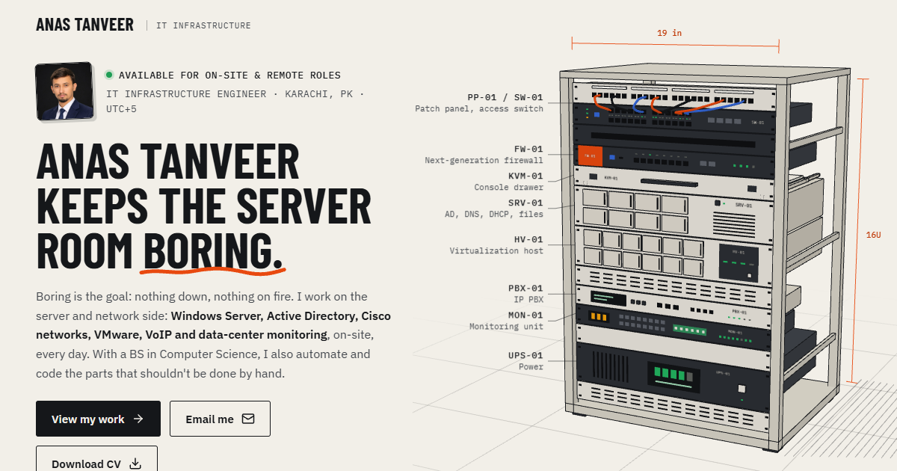

# Anas Tanveer · Portfolio

Personal site of Anas Tanveer, IT infrastructure engineer (servers and networks) in Karachi.

**Live:** [anastanveerr.vercel.app](https://anastanveerr.vercel.app)



## What's on it

- **Hero:** photo, role, availability, the tools I use, and four numbers from my public repositories.
- **"What I do":** a 3D server rack sits beside the text. As you scroll, the device that matches each block of text slides out: patch panel and switch, firewall, server, virtualization host, IP PBX, monitoring unit, and a console drawer that opens. You can drag the rack to turn it, and click a device to jump to its text.
- **About, how I work and experience:** my roles at R&I Electrical Appliances and my BS in Computer Science.
- **Projects:** each one links to its repository, with real screenshots or code from that repository.
- **Skills and contact.**

Everything on the page can be checked against my CV, my LinkedIn or the linked repositories. The rack is an illustration, not the layout of a real site.

## Stack

Plain HTML, CSS and JavaScript, with [three.js](https://threejs.org) for the rack. No framework and no build step.

```
index.html                    page content
assets/css/style.css          styles (paper-and-ink theme, responsive, honours prefers-reduced-motion)
assets/js/main.js             menu, scroll reveal, which text block is active, tilt, copy email, CV button
assets/js/rack.js             the 3D rack: every device is built from boxes in code, no models to download
assets/js/vendor/             three.js r170 (MIT), stored locally
assets/fonts/                 Barlow Condensed, IBM Plex Sans and IBM Plex Mono (OFL), stored locally
assets/img/                   photo, project screenshots, icon sprite, favicon, Open Graph image
assets/img/rack-still.webp    still image of the rack, shown when WebGL is not available
docs/                         CV PDF for the download button (see docs/README.md)
vercel.json                   security headers (CSP, frame and referrer policy) and caching
```

Icons come from [Lucide](https://lucide.dev) (ISC license), kept as a local SVG sprite. The hero tech icons come from [skillicons.dev](https://skillicons.dev). Fonts, icons and three.js are all stored in this repository, so the page loads nothing from a third-party server.

### How the rack behaves

- `main.js` works out which `.step` block is at the reading line and sends a `rack:step` event. `rack.js` listens and moves the camera and the matching device.
- `main.js` loads `rack.js` only after the page itself has loaded, so the 3D scene never delays the text. Visitors who turned on data saving get the still image instead.
- The scene only renders while it is on screen and the tab is visible, and at half the frame rate when nothing is moving.
- If frames stay slow (an old phone), it first drops the resolution and then switches to the still image.
- With `prefers-reduced-motion`, there is no intro, sway or blinking, and changes happen at once.
- Without WebGL or JavaScript, `rack-still.webp` is shown instead and the page reads the same.

## Run locally

Any static file server works, for example:

```bash
npx serve .
```

Then open the address it prints. Opening `index.html` straight from disk does not work: browsers block JavaScript modules and the icon sprite over `file://`.

## Deploy

Vercel deploys `main` as a static site, with no build settings needed. The headers in `vercel.json` include a strict Content-Security-Policy. Scripts, styles and fonts are only allowed from this site. If you add an inline script, add its SHA-256 hash to `script-src`. Inline `style` attributes are blocked, so set styles from the stylesheet or from JavaScript.

## Updating

- **CV:** replace `docs/Anas_Tanveer_CV.pdf` (same filename). The "Download CV" button only shows while that file exists.
- **Rack devices:** the `LAYOUT` list at the top of `assets/js/rack.js` sets what sits in which rack unit, and `data-step` on each `.step` in `index.html` links text to devices.
- **Testimonials:** a comment in `index.html` marks where they go. Only add real quotes, with permission.
