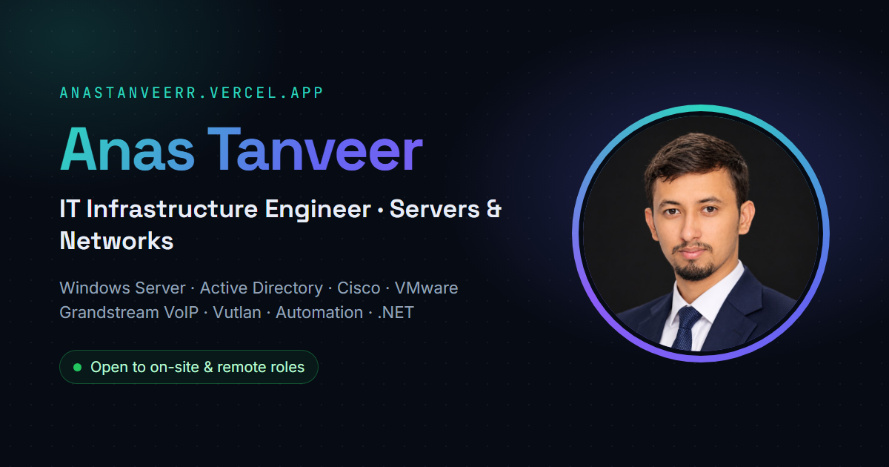

# Anas Tanveer · Portfolio

Personal site of Anas Tanveer, IT infrastructure engineer (servers and networks) in Karachi.

**Live:** [anastanveerr.vercel.app](https://anastanveerr.vercel.app)



## What's on it

- **Hero:** role, availability (on-site and remote), and the tools I use day to day.
- **Highlights:** numbers taken from my public repositories: 107 hardening controls, 6 Linux distributions in CI, 21 unit-tested alerts, 5 CI-tested projects.
- **About, services and how I work.**
- **Experience:** my roles at R&I Electrical Appliances and my BS in Computer Science.
- **Projects:** each one links to its repository, with real screenshots or code from that repository.
- **Skills and contact.**

Everything on the page can be checked against my CV, my LinkedIn or the linked repositories.

## Stack

Plain HTML, CSS and JavaScript. No framework and no build step.

```
index.html             page content
assets/css/style.css   styles (dark theme, responsive, honours prefers-reduced-motion)
assets/js/main.js      menu, scroll reveal, role rotator, copy email, CV button
assets/img/            photo, project screenshots, icon sprite, favicon, Open Graph image
docs/                  CV PDF for the download button (see docs/README.md)
vercel.json            security headers (CSP, frame and referrer policy) and caching
```

Icons come from [Lucide](https://lucide.dev) (ISC license), kept as a local SVG sprite. The hero tech icons come from [skillicons.dev](https://skillicons.dev) and are also stored locally. Nothing loads from a third-party server except Google Fonts.

## Run locally

Any static file server works, for example:

```bash
npx serve .
```

Then open the address it prints. Opening `index.html` straight from disk also works, but browsers block the icon sprite over `file://`.

## Deploy

Vercel deploys `main` as a static site, with no build settings needed. The headers in `vercel.json` include a strict Content-Security-Policy. If you add an inline script, add its SHA-256 hash to `script-src`.

## Updating

- **CV:** replace `docs/Anas_Tanveer_CV.pdf` (same filename). The "Download CV" button only shows while that file exists.
- **Testimonials:** a comment in `index.html` marks where they go. Only add real quotes, with permission.
